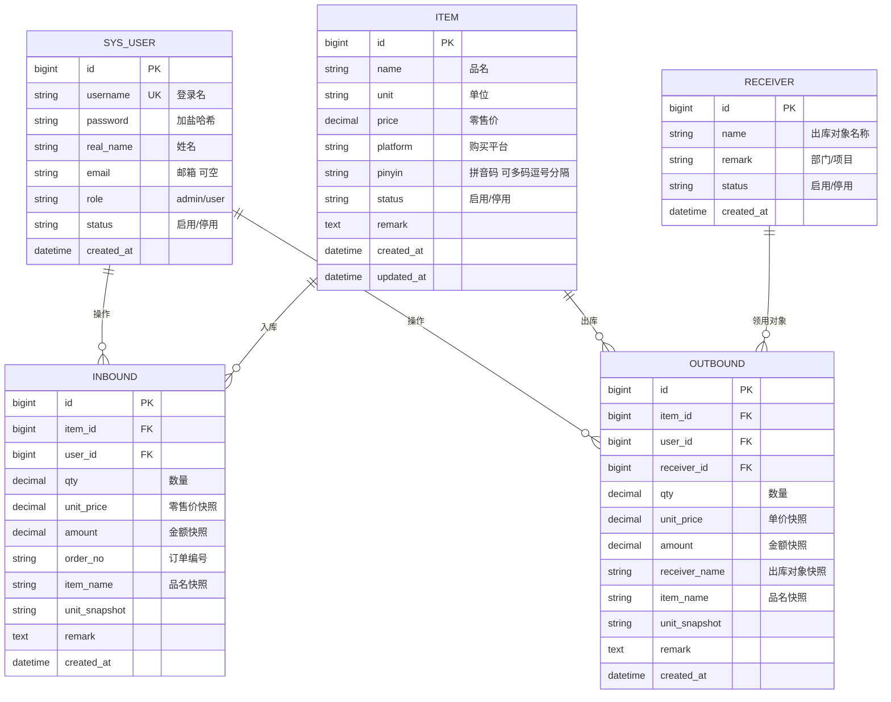

# 物资系统 · 产品需求文档（PRD）

| 项目 | 内容 |
| --- | --- |
| 产品名称 | 物资系统 |
| 文档版本 | v1.0 |
| 文档状态 | 待评审 |
| 编写人 | 产品经理 |
| 编写日期 | 2026-10-26 |
| 目标读者 | 开发、测试、需求方 |

---

## 目录

1. [产品概述](#1-产品概述)
2. [角色与权限](#2-角色与权限)
3. [功能范围总览](#3-功能范围总览)
4. [功能需求详述](#4-功能需求详述)
5. [数据模型](#5-数据模型)
6. [关键业务规则](#6-关键业务规则)
7. [页面清单](#7-页面清单)
8. [非功能需求](#8-非功能需求)
9. [验收标准](#9-验收标准)
10. [交付计划](#10-交付计划)
11. [待确认问题](#11-待确认问题)

---

## 1. 产品概述

### 1.1 产品定位

> 一个轻量的物资出入库记录工具：**用拼音码快速录入物资的进与出，随时查到还剩多少。**

### 1.2 要解决的问题

个人/小团队的物资（办公用品、家居耗材、数码配件、活动物资等）目前靠记忆或随手记录，存在三个问题：

1. **查不到**：不知道某个物资还有多少，需要时得翻箱倒柜；
2. **记不清**：记了"买了鼠标"，但忘了在哪买、多少钱、什么订单号；
3. **记不快**：传统台账要开表、填公式，一次记一笔超过 1 分钟，导致根本记不下去。

因此本系统的设计重点是：**录入必须极快**——出库和入库都通过**拼音码**定位物资，输入两个值（数量、订单号/出库对象）即可完成一次记录。

### 1.3 目标用户

| 用户 | 说明 |
| --- | --- |
| 管理员（admin） | 最高权限，负责人员账号维护，拥有全部功能 |
| 普通用户 | 注册或由管理员创建后登录，进行物资维护与出入库记录 |

### 1.4 核心价值

| 价值点 | 实现方式 |
| --- | --- |
| 录得快 | 拼音码定位 + 连续录入，单条记录 5~10 秒 |
| 记得全 | 物资属性（品名/单位/零售价/购买平台/拼音码）统一建档，一次录入长期复用 |
| 查得到 | 结存实时计算，库存页一目了然 |

### 1.5 本期不做（明确排除）

以下内容本期**不实现**，避免范围膨胀：

- ❌ 审批流、报价/供应商/采购合同管理
- ❌ 成本核算、利润分析、财务凭证
- ❌ 批次、效期、序列号、库位等多维度仓储管理
- ❌ 附件/图片上传、订单截图凭证
- ❌ 与电商平台 API 自动同步
- ❌ 多租户/部门数据隔离、复杂自定义字段
- ❌ 数据看板、复杂报表、Excel 导入导出（V2 视需求再评估）

---

## 2. 角色与权限

### 2.1 角色定义

| 角色 | 说明 |
| --- | --- |
| **admin** | 最高权限。系统内置，不可删除。可管理全部人员、物资、出入库数据 |
| **普通用户** | 默认角色。可维护物资、录入出入库、查看库存；**不可**维护人员信息 |

### 2.2 权限矩阵

| 功能 | admin | 普通用户 |
| --- | :---: | :---: |
| 登录 / 注册 / 忘记密码 | ✅ | ✅ |
| 物资产品维护（新增、编辑） | ✅ | ✅ |
| 物资产品删除 / 停用 | ✅ | ❌ |
| 入库记录 | ✅ | ✅ |
| 出库记录 | ✅ | ✅ |
| 库存查询 | ✅ | ✅ |
| 出库对象（个人）维护 | ✅ | ✅（可新增自己的出库对象） |
| **人员信息维护** | ✅ | ❌ |
| 重置他人密码 | ✅ | ❌ |
| 停用/启用人员账号 | ✅ | ❌ |

> 规则要点：**人员信息是唯一 admin 专属的模块**，其余业务模块所有登录用户均可操作。

---

## 3. 功能范围总览

| 编号 | 模块 | 核心输入 | 核心输出 | 优先级 |
| --- | --- | --- | --- | --- |
| F1 | 登录与账号 | 用户名、密码、邮箱 | 会话 | P0 |
| F2 | 物资产品维护 | 品名、单位、零售价、购买平台、拼音码 | 物资档案 | P0 |
| F3 | 物资入库 | 拼音码、数量、订单编号 | 入库记录 + 结存增加 | P0 |
| F4 | 物资出库 | 拼音码、数量、出库到个人 | 出库记录 + 结存减少 | P0 |
| F5 | 人员信息维护 | 用户名、姓名、角色、状态 | 账号管理 | P0 |
| F6 | 库存查询 | 筛选条件 | 结存清单 | P0（派生功能） |

> F6 是 F3/F4 的必要结果呈现：只记录不看数，系统没有价值。实现上为最简单的一张列表页，不含图表与报表。

---

## 4. 功能需求详述

### F1 登录与账号

#### F1.1 内置管理员账号

- 系统首次运行**无任何预置用户数据**，但内置一个超级管理员账号：**用户名 `admin`，密码 `admin`**。
- 该账号为**最高权限**（角色 `admin`），用于首次登录后创建其他人员账号。
- 首次使用 `admin/admin` 登录成功后，**强制跳转修改密码**页面，修改完成前无法使用其他功能。
- `admin` 账号**不可删除**、**不可停用**、**不可降级**。

#### F1.2 登录

| 项 | 需求 |
| --- | --- |
| 入口 | `/login` |
| 输入 | 用户名、密码 |
| 校验 | 用户名/密码必填；账号不存在或密码错误统一提示 **"用户名或密码错误"**（不暴露账号是否存在） |
| 失败处理 | 连续失败 5 次锁定该账号 15 分钟，提示剩余时间 |
| 成功行为 | 跳转首页，按角色加载菜单；记录登录日志（登录时间、IP） |
| 会话 | 无操作 8 小时自动登出；右上角显示当前用户，可手动退出 |

#### F1.3 注册

| 项 | 需求 |
| --- | --- |
| 入口 | 登录页「注册新账号」 |
| 输入 | 用户名、密码、确认密码、姓名（显示名）、邮箱（**选填**） |
| 用户名规则 | 3~20 位，字母/数字/下划线，全局唯一，**不可修改** |
| 密码规则 | 6~20 位，至少包含字母和数字；两次输入一致 |
| 邮箱规则 | 格式校验；同一邮箱不可被多个账号绑定（找回密码用） |
| 默认角色 | **普通用户**（注册用户不具备人员管理权限） |
| 唯一性 | 用户名重复时明确提示"该用户名已被注册" |
| 注册后 | 直接登录并进入首页；若系统配置为"需管理员审核"，则提示"已提交，等待管理员审核"（默认不审核） |

#### F1.4 忘记密码

两种路径，按用户是否绑定邮箱自动分流：

**路径 A：已绑定邮箱（自助找回）**

1. 在登录页点击「忘记密码」→ 输入用户名或邮箱 → 提交；
2. 系统生成 6 位数字验证码，**有效期 10 分钟**，发送至该账号绑定邮箱；
3. 用户输入验证码 + 新密码 + 确认密码 → 提交；
4. 校验通过 → 密码重置成功 → 跳转登录页。

**路径 B：未绑定邮箱（联系管理员）**

- 提交后提示：**"该账号未绑定邮箱，请联系管理员重置密码"**；
- 管理员登录后，在「人员信息维护 → 重置密码」中直接为该用户设置新密码。

**路径 C：内置 admin 忘记密码（运维兜底）**

- admin 账号未绑定邮箱且不可通过路径 B 自助找回；
- 提供运维重置方式（部署时执行一条重置命令，将 `admin` 密码重置为 `admin`）；
- 该方式仅限服务器本机操作，不通过界面暴露。

> **安全约束**：验证码**不**在任何接口响应中回显；同一账号 1 小时内最多发送 3 次验证码；重置密码成功后使该账号所有已登录会话失效。

#### F1.5 退出登录

- 右上角用户菜单 →「退出登录」→ 清除会话并跳转登录页。

---

### F2 物资产品维护

#### F2.1 用户故事

> 作为**普通用户**，我希望把物资的品名、单位、零售价、购买平台登记一次，之后每次出入库只需输入拼音码就能直接带出这些信息。

#### F2.2 物资档案字段

| 字段 | 类型 | 必填 | 说明与校验 |
| --- | --- | :---: | --- |
| **品名** | 字符串 | ✅ | 1~50 字符。同一品名允许存在多条记录（如不同规格/不同店铺的同款），不做唯一限制 |
| **单位** | 字符串 | ✅ | 1~10 字符。下拉可选（个/件/套/盒/包/瓶/袋/箱/卷/米/千克/张/台/支），也可自定义输入 |
| **零售价** | 数字 | ✅ | ≥ 0，保留 2 位小数。用于计算入库金额（数量 × 零售价） |
| **购买平台** | 字符串 | ✅ | 1~30 字符。下拉可选（淘宝/天猫/京东/拼多多/1688/抖音/小红书/线下/其他），也可自定义输入 |
| **品名拼音码** | 字符串 | ✅ | 详见 [2.3 拼音码规则](#f23-拼音码规则) |
| 备注 | 文本 | ❌ | ≤ 100 字符 |
| 创建人/时间、最后修改人/时间 | — | 系统 | 自动记录 |

#### F2.3 拼音码规则

| 项 | 规则 |
| --- | --- |
| 生成方式 | 录入品名后**自动生成**首字母简拼，可手动修改 |
| 示例 | 无线鼠标 → `wsm`；A4 纸 → `a4z`；数据线 → `sjx` |
| 长度 | 1~20 位 |
| 字符集 | 小写字母 `a-z`、数字 `0-9` |
| 多码支持 | 一个字段内可写多个码，用**逗号或空格分隔**，如 `wsm, sb`（无线鼠标 / 鼠标），**任一码都能查到该物资** |
| 唯一性 | **不做唯一限制**，多个物资可有相同拼音码（搜索时全部列出，由用户选择） |
| 匹配方式 | 输入即模糊匹配（输入 `ws` 可匹配 `wsm`），按匹配前缀优先排序 |

#### F2.4 功能项

| 编号 | 功能 | 说明 | 权限 |
| --- | --- | --- | --- |
| F2.4.1 | 物资列表 | 分页列表，展示：拼音码、品名、单位、零售价、购买平台、当前结存、状态、操作列 | 全部 |
| F2.4.2 | 搜索 | 按**拼音码**（主）、品名、平台模糊搜索；支持按平台筛选 | 全部 |
| F2.4.3 | 新增物资 | 表单录入 F2.2 全部字段 | 全部 |
| F2.4.4 | 编辑物资 | 修改 F2.2 字段 | 全部 |
| F2.4.5 | 删除物资 | 仅当该物资**从未产生过入库/出库记录**时允许删除；否则按钮禁用并提示"已有出入库记录，不可删除" | 仅 admin |
| F2.4.6 | 停用物资 | 已有记录的物资可停用；停用后不出现在入库/出库的拼音码搜索结果中，历史记录保留 | 仅 admin |

#### F2.5 交互要点

- 新增/编辑采用**弹窗表单**，不跳页，保存后回到列表并定位到新增行。
- 拼音码输入框旁有「重新生成」按钮，按当前品名重算。
- 列表为空时展示引导："还没有物资，点右上角『新增物资』开始"。

---

### F3 物资入库

#### F3.1 用户故事

> 作为**普通用户**，我在收到货后，希望输入拼音码和数量、订单号，就完成一次入库登记。

#### F3.2 录入界面

```
┌────────────────────────────────────────────────────────────────┐
│  物资入库                                                       │
├────────────────────────────────────────────────────────────────┤
│  拼音码 *   [ wsm________________ ]  [搜索结果 ▼]                │
│                                                                │
│  ┌──────────────────────────────────────────────────────────┐  │
│  │  无线鼠标   单位: 个   零售价: ¥29.90   购买平台: 淘宝     │  │
│  └──────────────────────────────────────────────────────────┘  │
│                                                                │
│  数量 *      [ 2            ]                                  │
│  订单编号 *  [ 20261026T12345________ ]                        │
│                                                                │
│  提交本条 (Enter)              [提交并继续录入下一条]          │
│                                        [查看全部入库记录]      │
└────────────────────────────────────────────────────────────────┘
```

#### F3.3 字段定义

| 字段 | 类型 | 必填 | 说明 |
| --- | --- | :---: | --- |
| 拼音码 | 字符串 | ✅ | 输入后按 F2.3 规则检索物资 |
| 物资 | 关联 | ✅ | 拼音码唯一确定时自动选中；匹配到多个时弹出候选列表供选择 |
| 数量 | 数字 | ✅ | > 0，保留 3 位小数（支持 0.5 等小数） |
| 订单编号 | 字符串 | ✅ | 1~64 字符。用于回溯"这批货从哪来" |
| 入库日期 | 日期 | 系统 | 默认当前时间，**不可修改** |
| 操作人 | 关联 | 系统 | 默认当前登录用户，**不可修改** |
| 入库金额 | 数字 | 系统 | = 数量 × 该物资的零售价（自动计算，只读） |

#### F3.4 操作流程

1. 焦点默认落在**拼音码**输入框；
2. 输入拼音码 → 实时展示匹配结果（品名/单位/零售价/平台）→ 唯一匹配则自动选中，多个匹配则下拉列表选择；
3. 自动带出单位、零售价、购买平台（只读展示，减少输入）；
4. 输入数量、订单编号；
5. 提交 → 成功提示「入库成功：无线鼠标 ×2」→ **清空表单，光标自动回到拼音码**，可连续录入下一条；
6. 该物资结存即时增加。

#### F3.5 业务规则

| 编号 | 规则 |
| --- | --- |
| R3.1 | 拼音码必须匹配到至少一个**启用状态**的物资，否则禁止提交 |
| R3.2 | 数量必须 > 0，最多 3 位小数 |
| R3.3 | 订单编号必填；**不限制重复**（同一订单可能分批入库） |
| R3.4 | 提交成功后：该物资结存 += 数量，写入一条入库记录 |
| R3.5 | 入库记录的品名、单位、零售价、购买平台按**提交时的值做快照保存**，后续修改物资档案不影响历史记录 |
| R3.6 | 记录不可编辑、不可删除（保证账目可追溯） |

---

### F4 物资出库

#### F4.1 用户故事

> 作为**普通用户**，我把物资发给某个人时，希望记录"哪个物资、多少、给了谁"，以便知道东西去了哪。

#### F4.2 录入界面

```
┌────────────────────────────────────────────────────────────────┐
│  物资出库                                                       │
├────────────────────────────────────────────────────────────────┤
│  拼音码 *   [ wsm________________ ]  [搜索结果 ▼]                │
│  ┌──────────────────────────────────────────────────────────┐  │
│  │  无线鼠标   单位: 个   当前结存: 3                        │  │
│  └──────────────────────────────────────────────────────────┘  │
│                                                                │
│  数量 *        [ 1            ]        (最大可出: 3)           │
│  出库到 *      [ 张三            ▾ ]  [+ 新增出库对象]        │
│                                                                │
│  提交本条 (Enter)              [提交并继续录入下一条]          │
└────────────────────────────────────────────────────────────────┘
```

#### F4.3 字段定义

| 字段 | 类型 | 必填 | 说明 |
| --- | --- | :---: | --- |
| 拼音码 | 字符串 | ✅ | 同 F3.3 |
| 物资 | 关联 | ✅ | 同 F3.3 |
| 数量 | 数字 | ✅ | > 0，保留 3 位小数；**不可超过当前结存** |
| **出库到（个人）** | 字符串 | ✅ | 详见 [4.4 出库对象](#f44-出库对象个人) |
| 备注 | 文本 | ❌ | ≤ 100 字符，如"项目现场使用"、"借用" |
| 出库日期 | 日期 | 系统 | 默认当前时间，不可修改 |
| 操作人 | 关联 | 系统 | 默认当前登录用户，不可修改 |

#### F4.4 出库对象（个人）

出库对象是"物资发给了谁"，是**用户自行编辑定义的自由名称**，不限于系统登录用户。

| 项 | 规则 |
| --- | --- |
| 来源 | 一个可维护的**出库对象列表**（独立于系统用户） |
| 录入方式 | 下拉选择已定义的对象；或直接输入新名字，提交时**自动加入列表** |
| 对象字段 | 名称（必填，1~20 字符）、备注（选填，如所属部门/项目/班组） |
| 列表维护位置 | 出库页的「出库对象管理」弹窗 + 设置页；**所有登录用户**均可新增、编辑、删除 |
| 删除规则 | 已有出库记录引用的出库对象**不可删除**，仅可停用（不出现在选择列表，历史记录保留） |
| 典型取值 | 张三、李四、王五、项目A施工组、办公室、部门A |

#### F4.5 业务规则

| 编号 | 规则 |
| --- | --- |
| R4.1 | 出库数量 > 0，且**不得超过该物资当前结存**；超出时阻断提交，提示"当前结存为 N，超出 M" |
| R4.2 | 出库对象必填；若为新名称，提交时自动创建到出库对象列表 |
| R4.3 | 提交成功后：该物资结存 -= 数量，写入一条出库记录（含出库对象快照） |
| R4.4 | 出库记录同样保存品名/单位/出库对象的快照，物资档案后续修改不影响历史 |
| R4.5 | 出库记录不可编辑、不可删除 |

---

### F5 人员信息维护

> **本模块仅 admin 可见、可用**。普通用户登录后不显示此菜单，直接访问 URL 返回"无权限"。

#### F5.1 人员列表

| 列 | 说明 |
| --- | --- |
| 用户名 | 登录名，唯一，不可修改 |
| 姓名 | 显示名，可修改 |
| 角色 | admin / 普通用户 |
| 邮箱 | 忘记密码用，可修改 |
| 状态 | 启用 / 停用 |
| 创建时间 | — |
| 操作 | 重置密码、编辑、停用/启用、删除 |

#### F5.2 新增人员

| 字段 | 必填 | 说明 |
| --- | :---: | --- |
| 用户名 | ✅ | 3~20 位，字母/数字/下划线，全局唯一，创建后不可修改 |
| 初始密码 | ✅ | 6~20 位，至少含字母和数字；**创建时可见并由 admin 转告本人**，本人首次登录后提示修改 |
| 姓名 | ✅ | 1~20 字符 |
| 邮箱 | ❌ | 格式校验；绑定后该用户可自助找回密码 |
| 角色 | ✅ | admin / 普通用户；**admin 角色仅 admin 可分配，且系统内至少保留 1 个启用状态的 admin** |
| 状态 | ✅ | 默认启用 |

#### F5.3 人员操作

| 操作 | 权限 | 规则 |
| --- | --- | --- |
| 编辑 | admin | 修改姓名、邮箱、角色、状态；用户名不可改 |
| 重置密码 | admin | 直接设置新密码；该用户所有已登录会话立即失效 |
| 停用 | admin | 账号不可登录，历史记录保留；**不允许停用最后一个启用状态的 admin** |
| 启用 | admin | 恢复登录能力 |
| 删除 | admin | 仅当该用户**从未产生过入库/出库记录**时允许删除；否则提示"该用户有操作记录，请改为停用" |

#### F5.4 保护性约束

| 编号 | 规则 |
| --- | --- |
| R5.1 | admin 不能删除/停用/降级**自己**的账号 |
| R5.2 | 系统内至少保留 1 个启用状态的 admin 账号 |
| R5.3 | 停用某用户后，该用户已登录的会话在下次请求时失效 |
| R5.4 | 所有人员变更写入操作日志（谁、何时、改了什么） |

---

### F6 库存查询

#### F6.1 库存清单

| 列 | 说明 |
| --- | --- |
| 拼音码 | — |
| 品名 | — |
| 单位 | — |
| **当前结存** | = 累计入库 − 累计出库 |
| 零售价 | — |
| 库存金额 | = 结存 × 零售价 |
| 购买平台 | — |
| 最近变动 | 最近一次出入库时间 |
| 状态 | 启用/停用；有结存但长期未变动可标"久未使用" |

#### F6.2 规则

| 编号 | 规则 |
| --- | --- |
| R6.1 | 结存 = Σ(该物资所有入库记录.数量) − Σ(该物资所有出库记录.数量) |
| R6.2 | 库存金额 = 结存 × 该物资的**当前**零售价（为简化核算，零售价变动会影响库存金额；入库/出库记录中已保存当时的单价快照，报表口径以快照为准） |
| R6.3 | 支持按拼音码/品名搜索、按平台筛选；提供"只看有结存"、"只看结存为 0"的快捷筛选 |
| R6.4 | 零结存的物资**默认隐藏**，可通过筛选查看 |

#### F6.3 出入库记录查看

- 独立的「入库记录」「出库记录」列表页，按时间倒序；
- 字段：时间、拼音码、品名、数量、单价/金额、订单编号（入库）/ 出库对象（出库）、操作人、备注；
- 支持按拼音码、品名、时间区间、操作人搜索；
- **只读，不可编辑、不可删除**。

---

## 5. 数据模型

### 5.1 ER 图



### 5.2 数据表说明

| 表名 | 说明 | 关键约束 |
| --- | --- | --- |
| `sys_user` | 系统用户（登录账号） | `username` 唯一；内置 admin 不可删 |
| `item` | 物资档案 | 无唯一约束；`pinyin` 建普通索引 |
| `inbound` | 入库记录 | **只增不改不删**；含快照字段 |
| `outbound` | 出库记录 | **只增不改不删**；含快照字段 |
| `receiver` | 出库对象（个人）列表 | `name` 唯一；被引用后不可删 |

### 5.3 索引建议

| 表 | 索引 | 用途 |
| --- | --- | --- |
| `sys_user` | `username`(唯一) | 登录 |
| `item` | `pinyin`、`name` | 拼音码/品名搜索 |
| `inbound` | `item_id + created_at` | 结存汇总、按物资查历史 |
| `outbound` | `item_id + created_at`、`receiver_id` | 结存汇总、按对象查去向 |

---

## 6. 关键业务规则

| 编号 | 类别 | 规则 |
| --- | --- | --- |
| G1 | 库存 | 结存 = Σ入库数量 − Σ出库数量（按物资） |
| G2 | 库存 | 出库数量不得超过结存，超出则阻断提交 |
| G3 | 金额 | 入库金额 = 数量 × 零售价；库存金额 = 结存 × 当前零售价 |
| G4 | 精度 | 数量最多 3 位小数；价格/金额 2 位小数 |
| G5 | 快照 | 入库/出库记录保存提交时的品名、单位、单价、平台、出库对象，后续档案修改不影响历史 |
| G6 | 不可变 | 入库、出库记录一律不可编辑、不可删除 |
| G7 | 事务 | 记录写入与结存更新必须在同一事务中，失败整体回滚 |
| G8 | 时间 | 记录时间取服务器当前时间，不允许用户修改 |
| G9 | 拼音码 | 唯一性不校验；搜索时按前缀优先排序，多结果由用户选择 |
| G10 | 权限 | 人员信息维护仅 admin；内置 admin 账号受保护不可删除/停用/降级 |

---

## 7. 页面清单

> 高保真 UI 原型已完成，见 [`../002.产品UI原型（美术设计）/index.html`](../002.产品UI原型（美术设计）/index.html)（双击即可打开，无需构建）。

| # | 页面 | 路径 | 可见角色 | 说明 | UI 原型 |
| --- | --- | --- | --- | --- | --- |
| 1 | 登录 | `/login` | 公开 | 登录、注册、忘记密码入口 | [01](../002.产品UI原型（美术设计）/01-login.html) |
| 2 | 注册 | `/register` | 公开 | — | [02](../002.产品UI原型（美术设计）/02-register.html) |
| 3 | 忘记密码 | `/forgot-password` | 公开 | 邮箱验证码重置 | [03](../002.产品UI原型（美术设计）/03-forgot-password.html) |
| 4 | 修改密码 | `/change-password` | 登录用户 | 首次登录强制进入 | [04](../002.产品UI原型（美术设计）/04-change-password.html) |
| 5 | 首页 / 库存 | `/` `/stock` | 登录用户 | 库存清单 + 快捷入口 | [05](../002.产品UI原型（美术设计）/05-home-stock.html) |
| 6 | 新增/编辑物资 | `/items`（弹窗） | 登录用户 | 物资档案维护 | [06](../002.产品UI原型（美术设计）/06-items.html) |
| 7 | 入库 | `/inbound/new` | 登录用户 | 拼音码快速录入 | [07](../002.产品UI原型（美术设计）/07-inbound-new.html) |
| 8 | 出库 | `/outbound/new` | 登录用户 | 拼音码快速录入 + 出库到个人 | [08](../002.产品UI原型（美术设计）/08-outbound-new.html) |
| 9 | 入库记录 | `/inbound` | 登录用户 | 只读列表 | [09](../002.产品UI原型（美术设计）/09-inbound-list.html) |
| 10 | 出库记录 | `/outbound` | 登录用户 | 只读列表 | [10](../002.产品UI原型（美术设计）/10-outbound-list.html) |
| 11 | 出库对象管理 | `/receivers` | 登录用户 | 增删改出库对象 | [11](../002.产品UI原型（美术设计）/11-receivers.html) |
| 12 | 人员信息 | `/users` | **仅 admin** | 人员增删改、重置密码 | [12](../002.产品UI原型（美术设计）/12-users.html) |

**导航结构**

```
物资系统
├── 首页（库存清单 + 快捷入口）
├── 入库          →  新建入库 / 入库记录
├── 出库          →  新建出库 / 出库记录 / 出库对象管理
├── 物资档案
└── 人员信息（仅 admin 可见）
```

---

## 8. 非功能需求

| 类别 | 要求 |
| --- | --- |
| 性能 | 拼音码搜索结果 200ms 内返回；列表页首屏 1s 内；提交响应 1s 内 |
| 数据量 | 支持 1 万条出入库记录、2000 个物资档案的流畅使用 |
| 安全 | 密码加盐哈希存储；全站 HTTPS；登录失败 5 次锁定 15 分钟；修改/重置密码后旧会话失效 |
| 兼容性 | Chrome / Edge 最新两个大版本；支持 375px 宽移动端浏览器（现场用手机记一笔） |
| 备份 | 每日自动备份数据库，保留 30 天 |
| 可用性 | 主要操作路径不超过 3 步；表单失焦即校验；错误信息用文字提示 |

---

## 9. 验收标准

| 编号 | 场景 | 预期结果 |
| --- | --- | --- |
| TC01 | 首次用 `admin/admin` 登录 | 登录成功，为最高权限；强制跳转修改密码页 |
| TC02 | 首次登录后修改密码 | 修改成功，可用新密码登录；旧密码失效 |
| TC03 | 注册新用户 | 注册成功并自动登录，角色为普通用户；**看不到「人员信息」菜单** |
| TC04 | 重复用户名注册 | 明确提示"该用户名已被注册"，不创建记录 |
| TC05 | 密码错误登录 | 提示"用户名或密码错误"；连续 5 次锁定 15 分钟 |
| TC06 | 绑定邮箱的用户忘记密码 | 输入用户名 → 收到 6 位验证码 → 验证码正确 → 重置成功 → 新密码可登录 |
| TC07 | 未绑定邮箱的用户忘记密码 | 提示"该账号未绑定邮箱，请联系管理员重置密码" |
| TC08 | 验证码过期/错误 | 明确提示"验证码错误或已过期"，可重新获取 |
| TC09 | 新增物资 | 填写品名"无线鼠标"→ 自动生成拼音码 `wsm` → 保存成功，列表出现该物资 |
| TC10 | 手动修改拼音码 | 可改为 `wsm,sb`；用 `sb` 也能搜索到该物资 |
| TC11 | 非 admin 删除有出入库记录的物资 | 删除按钮禁用，提示"已有出入库记录，不可删除" |
| TC12 | 拼音码入库 | 输入 `wsm` → 自动带出"无线鼠标/个/¥29.90/淘宝" → 填数量 2、订单号 20261026T12345 → 提交成功 |
| TC13 | 提交后连续录入 | 提交成功提示后表单清空，光标回到拼音码，可直接录下一条 |
| TC14 | 入库后库存变化 | 该物资结存 = 2；入库记录列表新增 1 条，含数量、订单号、操作人、时间 |
| TC15 | 数量为 0 或负数 | 表单报错，无法提交 |
| TC16 | 拼音码无匹配 | 提示"未找到匹配的物资"，无法提交 |
| TC17 | 出库给个人 | 输入 `wsm` → 带出"当前结存 3" → 数量 1 → 出库对象选"张三" → 提交成功，结存变为 2 |
| TC18 | 出库到新对象 | 出库对象直接输入"项目A施工组" → 提交成功，且该名称自动出现在出库对象列表 |
| TC19 | 出库数量超结存 | 数量填 5、结存为 2 → 阻断提交，提示"当前结存为 2，超出 3" |
| TC20 | 出库记录可追溯 | 出库记录列表显示"出库到 张三"、数量、操作人、时间；物资档案改价不影响历史记录显示 |
| TC21 | admin 新增人员 | 创建成功，初始密码可见；该用户可登录；**不能**进入人员信息页 |
| TC22 | admin 重置他人密码 | 重置成功，该用户旧密码失效、旧会话失效 |
| TC23 | 普通用户访问 `/users` | 返回无权限页面，菜单中不显示入口 |
| TC24 | 删除有操作记录的人员 | 阻止删除，提示"该用户有操作记录，请改为停用"；停用后该用户无法登录 |
| TC25 | 最后一个 admin 被停用 | 阻止操作，提示必须保留至少一个管理员 |

---

## 10. 交付计划

| 阶段 | 内容 | 产出 |
| --- | --- | --- |
| 第 1 阶段 | 登录/注册/忘记密码、角色权限、admin 保护 | 账号体系可用 |
| 第 2 阶段 | 物资档案维护、拼音码生成与搜索 | 可建档可检索 |
| 第 3 阶段 | 入库、出库、结存计算、记录列表 | **核心闭环可用** |
| 第 4 阶段 | 出库对象管理、库存页优化、测试与上线 | 正式使用 |

> 第 3 阶段结束后系统已可投入真实使用；第 4 阶段为体验优化与验收。

---

## 11. 待确认问题

| 编号 | 问题 | 建议 |
| --- | --- | --- |
| Q1 | 物资档案是否允许重名 | 建议允许（同款不同规格常见），列表加区分提示 |
| Q2 | 零售价是否需要区分"采购价/售价" | 本期只记一个零售价，按录入时的价格快照保存到记录中 |
| Q3 | 出库对象是否要与系统人员打通 | 本期完全独立、自由定义；打通需增加"关联系统用户"字段 |
| Q4 | 购物平台是否做固定下拉 + 可自定义 | 建议固定常用项 + 允许自定义输入 |
| Q5 | 是否需要历史记录作废/冲销功能 | 本期不提供（保持"记录不可改"），若出现录错需求再补 |
| Q6 | 注册用户是否需要管理员审核后才可登录 | 建议不需要（自助注册即可用） |
| Q7 | 是否需要数据导出/备份下载 | 本期仅服务器端自动备份；如需人工导出可再加 |
| Q8 | 物资数量是否需要重量/体积类小数（如 0.5 米） | 建议支持，数量保留 3 位小数 |

---

## 附录 · 文档修订记录

| 版本 | 日期 | 修改人 | 修改内容 |
| --- | --- | --- | --- |
| v1.0 | 2026-10-26 | 产品经理 | 按实际需求精简重写：登录/注册/找回密码、物资档案（含拼音码）、拼音码快速出入库、出库到个人、人员信息维护（admin 专属）、库存查询 |
